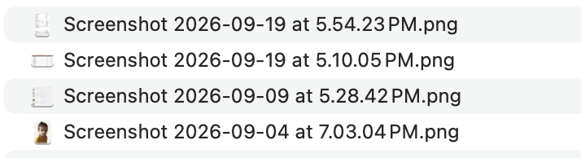
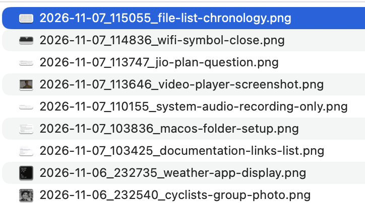
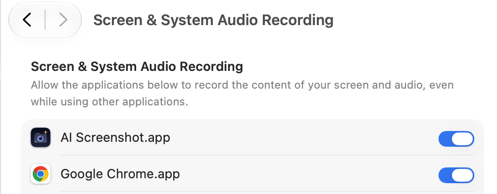
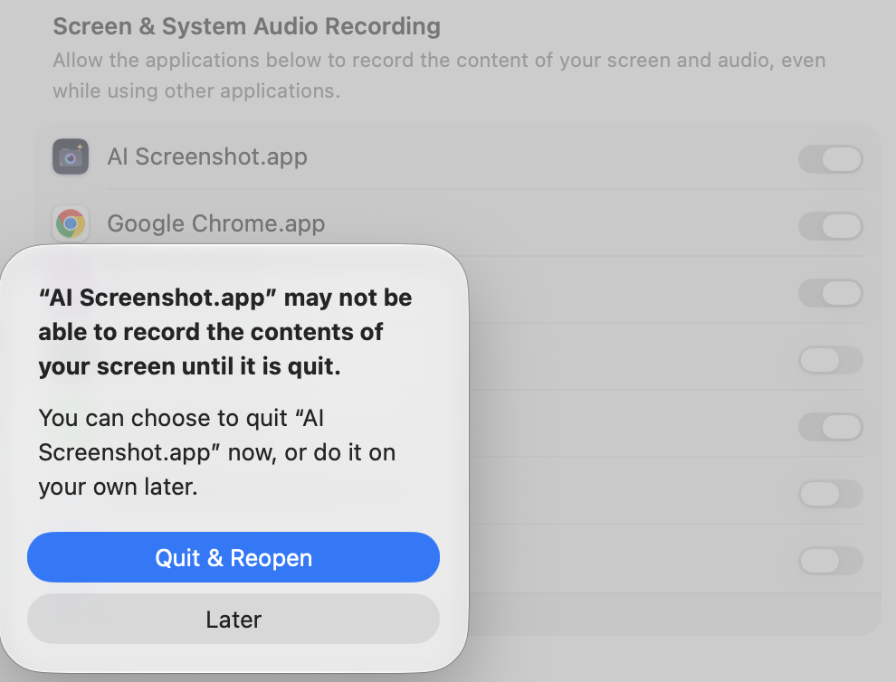

# 📸 AI Screenshot

[](https://github.com/manojm321/ai-screenshot/actions/workflows/build.yml)
[](LICENSE)
[-black.svg)](https://apple.com)

Replace default screenshot names with **on-device AI descriptions** using Apple Foundation Models (`fm`).

No API keys. 100% local and private.

---

## ⚡️ Before & After

| Before | After |
|:---:|:---:|
|  |  |
| `Screenshot 2026-11-07...png` | `<slug>_<HHmmss>.png` |

---

## 🚀 Install

### Option 1: DMG Installer (Recommended)
Download **[`AI-Screenshot.dmg`](https://github.com/manojm321/ai-screenshot/releases)**, open it, and drag `AI Screenshot.app` to `Applications`.

### Option 2: Build & Install via Terminal
```bash
git clone https://github.com/manojm321/ai-screenshot.git
cd ai-screenshot && ./install.sh
```

---

## ⌨️ Usage

- **Capture**: Press **`⌘ + ⇧ + 1`** anywhere.
- **Floating Thumbnail**: Click to open, right-click to reveal in Finder, or drag & drop into Slack/Mail/Browser.
- **Menu Bar**: Click the camera icon for quick capture, Launch at Login, or to hide the icon.

<details>
<summary><b>🔒 First-Time Setup (Permissions)</b></summary>

1. In **System Settings > Privacy & Security > Screen & System Audio Recording**, enable **AI Screenshot.app**:

   

2. Click **Quit & Reopen** when prompted:

   
</details>

---

## 📄 License

[MIT](LICENSE)
