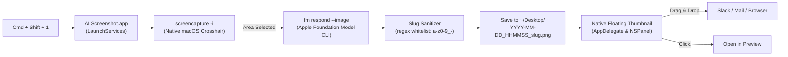

# 📸 AI Screenshot Renamer (`AI Screenshot.app`)

An open-source macOS utility that replaces standard screenshot naming with **AI-generated semantic descriptions + timestamps** using macOS's native on-device **Apple Foundation Models (`fm`) CLI**.

No API keys. No external servers. No running daemons. 100% on-device, private, and automated.

---

## ✨ Features

- **On-Device Vision AI**: Uses macOS's native `fm respond --image` command to analyze the screenshot content locally in ~1 second.
- **Strict, Clean Naming**:
  ```text
  YYYY-MM-DD_HHMMSS_<slug>.png
  ```
  - *Example*: `2026-11-07_104215_payment-details-list.png`
  - Sanitized strictly to alphanumeric characters (`a-z`, `A-Z`, `0-9`), hyphens (`-`), and underscores (`_`).
- **Native Floating Thumbnail**:
  - Displays a floating preview in the bottom-right corner for 4.5 seconds (just like macOS default).
  - **Click**: Opens screenshot in **Preview**.
  - **Right-Click**: Reveals screenshot in **Finder**.
  - **Drag & Drop**: Drag directly into Slack, Discord, Mail, or a web browser.
- **Interactive Capture**: Uses native `screencapture -i` for pixel-accurate crosshairs or window capture (`Space`).
- **First-Class macOS App**: Packaged as `AI Screenshot.app` with custom retina icon, proper TCC permissions attribution (no Automator runner alerts), and zero Dock pollution (`LSUIElement = true`).
- **Global Keyboard Shortcut**: Binds **`⌘ + ⇧ + 1`** (`Cmd + Shift + 1`) system-wide.
- **GitHub Actions CI**: Automated building and zip artifact generation on every commit and release.

---

## 🚀 Installation

### Option 1: One-Command Local Build & Install

```bash
git clone https://github.com/your-username/ai-screenshot.git
cd ai-screenshot
./install.sh
```

This compiles `AI Screenshot.app`, installs it to `/Applications`, and registers the global `⌘ + ⇧ + 1` shortcut.

### Option 2: Download Prebuilt from GitHub Releases / CI

1. Download `AI-Screenshot.zip` from the latest [GitHub Release](https://github.com/your-username/ai-screenshot/releases) or CI build artifact.
2. Unzip and drag `AI Screenshot.app` into your `/Applications` folder.
3. Run `./install.sh` (or `python3 install_service.py`) to bind the `⌘ + ⇧ + 1` shortcut.

---

## ⌨️ How the Shortcut Works

1. **Native App**: `AI Screenshot.app` lives in `/Applications` with bundle identifier `com.user.ai-screenshot`.
2. **Quick Action**: `~/Library/Services/AI Screenshot.workflow` launches `open -b com.user.ai-screenshot`. Because LaunchServices launches the app as its own process, macOS privacy prompts clearly show **"AI Screenshot"** instead of `com.apple.automator.xpc.runner`.
3. **Key Equivalent**: Registered in `~/Library/Preferences/pbs.plist` under `@$1` (`Cmd + Shift + 1`).

To uninstall anytime:
```bash
make uninstall
```

---

## 🛠 Architecture



---

## 🏗 Continuous Integration (CI)

The GitHub Actions workflow [`.github/workflows/build.yml`](.github/workflows/build.yml) automatically:
- Compiles the Swift binary with `swiftc -O` on macOS 14 runners (Apple Silicon).
- Generates high-res multi-scale retina `.icns` icons with `generate_icon.swift`.
- Assembles and code-signs `AI Screenshot.app`.
- Uploads the release-ready `AI-Screenshot.zip` as a GitHub Actions artifact.
- Publishes releases when tags matching `v*` are pushed.

---

## 📄 License

[MIT](LICENSE)
