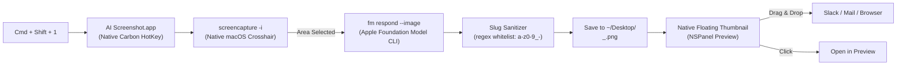

# 📸 AI Screenshot Renamer (`AI Screenshot.app`)

[](https://github.com/manojm321/ai-screenshot/actions/workflows/build.yml)
[](LICENSE)
[-black.svg)](https://apple.com/macos)

An open-source macOS utility that replaces messy, cryptic screenshot filenames with **AI-generated semantic descriptions + timestamps** using macOS's native on-device **Apple Foundation Models (`fm`) CLI**.

No API keys. No external servers. No telemetry. 100% on-device, private, and automated.

---

## ⚡️ Before & After

| Before (macOS Default) | After (`AI Screenshot`) |
|:---:|:---:|
|  |  |
| *Cryptic, hard to find and sort* | *Clear, completion-friendly `<slug>_<HHmmss>.png`* |

---

## ✨ Features

- **On-Device Vision AI**: Uses macOS's native `fm respond --image` command to analyze screenshot content locally in ~1 second.
- **Completion-Friendly Naming**:
  ```text
  <slug>_<HHmmss>.png
  ```
  - *Example*: `file-list-chronology_115121.png`
  - Slug comes first for instant shell autocompletion (`Tab`), globbing, and Spotlight searches.
  - Whitelist sanitized: lowercase letters (`a-z`), numbers (`0-9`), and hyphens (`-`).
- **Native Floating Thumbnail**:
  - Displays a floating preview in the bottom-right corner for 4.5 seconds (just like macOS default).
  - **Click**: Opens screenshot in **Preview**.
  - **Right-Click**: Reveals screenshot in **Finder**.
  - **Drag & Drop**: Drag directly into Slack, Discord, Mail, GitHub, or web browsers.
- **Interactive Capture**: Uses native `screencapture -i` for pixel-accurate crosshairs or window capture (`Space`).
- **Native Global Hotkey**: Registers **`⌘ + ⇧ + 1`** via macOS's native Carbon HotKey API (`RegisterEventHotKey`) with 0ms latency and no Accessibility permissions needed.
- **Menu Bar Companion**: Sleek camera status item in the menu bar with one-click capture, quick access to your screenshot directory, and Launch at Login toggle.
- **Hideable Menu Bar Icon**: Hide the menu bar icon anytime for an invisible, distraction-free setup (`⌘⇧1` continues to work in the background).
- **GitHub Actions CI**: Automated building and zip artifact generation on every commit and release.

---

## 🚀 Installation

### Option 1: One-Command Local Build & Install

```bash
git clone https://github.com/manojm321/ai-screenshot.git
cd ai-screenshot
./install.sh
```

This compiles `AI Screenshot.app`, installs it to `/Applications`, launches the background agent, and enables **`⌘ + ⇧ + 1`** immediately.

### Option 2: Download Prebuilt from GitHub Releases / CI

1. Download `AI-Screenshot.zip` from the latest [GitHub Release](https://github.com/manojm321/ai-screenshot/releases) or CI build artifact.
2. Unzip and drag `AI Screenshot.app` into your `/Applications` folder.
3. Launch `AI Screenshot.app`. It will appear in your top menu bar and listen for **`⌘ + ⇧ + 1`**.

---

## 🔒 First-Time Setup (Screen Recording Permission)

When taking your first screenshot, macOS TCC requires granting Screen Recording permission to `AI Screenshot.app`:

1. When prompted by macOS, open **System Settings > Privacy & Security > Screen & System Audio Recording**.
2. Enable the toggle for **AI Screenshot.app**:

   

3. When macOS prompts that the app needs to reload, click **Quit & Reopen**:

   

4. That's it! `AI Screenshot` will restart and is permanently authorized.

---

## ⌨️ How the Shortcut Works

1. **Native HotKey (`RegisterEventHotKey`)**: The app directly registers `⌘ + ⇧ + 1` with the macOS window server.
2. **Instant Response**: Handled directly in-process with 0ms latency.
3. **Launch at Login**: Click the camera icon in your top menu bar and check **Launch at Login** to keep `⌘ + ⇧ + 1` active across system restarts.
4. **Hiding & Restoring the Menu Bar Icon**:
   - **To hide**: Click the camera icon in your menu bar -> select **Hide Menu Bar Icon**.
   - **To restore**: Simply re-open `AI Screenshot` from `/Applications` or Spotlight, or run:
     ```bash
     open -a "AI Screenshot" --args --show-icon
     ```

To uninstall anytime:
```bash
make uninstall
```

---

## 🛠 Architecture



---

## 📄 License

[MIT](LICENSE)
